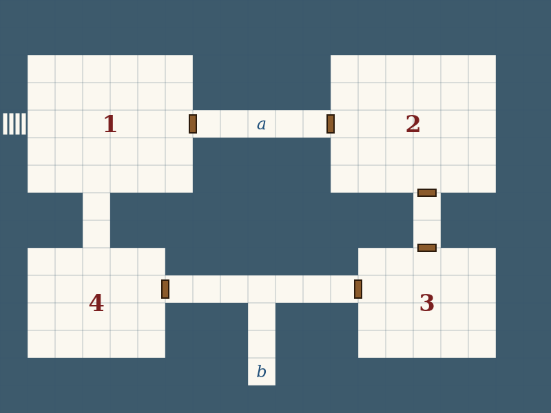
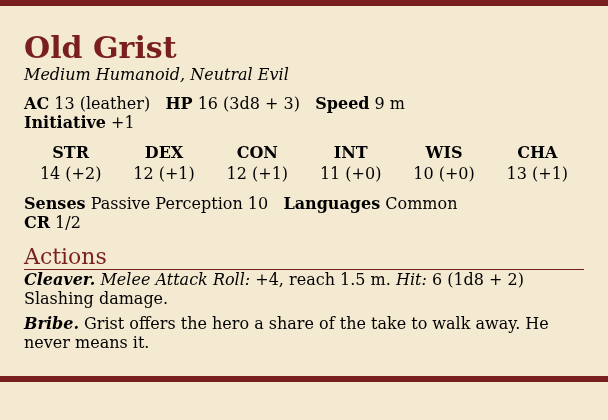

# Introduction

*The Miller's Cellar* is a short dungeon for one 1st-level hero. It was written
for the test suite of solo-dm and may be copied freely.

**The story.** Bram the miller keeps the village's grain ledger: who brought how
many sacks, and who owes what. Three nights ago smugglers moved into the cellar
under his mill, beat him senseless and stole the ledger. Their leader, a
river-trader called Old Grist, means to rewrite it and sell the village its own
grain back.

**The goal.** Get the ledger back to Bram. The adventure is won when the hero
comes back up into the mill yard with the Miller's Ledger, however they got it.

# Starting the adventure

The hero arrives in the **Mill Yard** at dusk. Bram's daughter, Wenna, meets
them by the water wheel. She offers the hero a *potion of healing* (it restores
2d4 + 2 hit points); a hero who asks to be paid instead gets 5 silver pieces and
no potion. Then she points to a hatch in the ground at the east side of the
yard: worn stone stairs lead down into the cellar.

# The cellar

The cellar is cut from the rock under the mill. Ceilings are 3 metres high,
the corridors are 1.5 metres wide, and every door is a plain wooden door unless
the text says otherwise. Map 1 shows the cellar; each square is 1.5 metres.

\newpage

{width=100%}

\newpage

## 1. Flour Store

The stairs from the yard come down through the west wall into a long room
stacked with flour sacks. A wooden door stands in the east wall, and an open
archway leads south.

A rusty **handaxe** (1d6 slashing) lies forgotten between two sacks.

**Flour dust.** The first time the hero comes in, a rotten sack splits and
flour dust fills the air. The hero must succeed on a DC 12 Constitution saving
throw or, coughing and half blind, have disadvantage on their next attack roll,
ability check or saving throw.

## 2. Millstone Room

A great millstone rests on its axle in the middle of this room; the shaft above
it runs up into the mill. The door in the west wall is a sturdy oak door with an
iron lock: it is locked, and its key hangs from the belt of one of the goblins
in area 4. A second door leads south.

The millstone is jammed with grit. A hero who puts their shoulder to it and
succeeds on a DC 12 Strength (Athletics) check turns it a full circle: with a
clank, the iron bolts on the trapdoor-door between areas C3 and 3 slide back.

**The loft.** A ladder leads up to a plank loft under the mill floor, 3 metres
above the millstone. Nothing up there can be seen from below. The ladder's rungs
are rotten: climbing it takes a DC 10 Strength (Athletics) check. On a failure
the hero falls (1d6 bludgeoning damage); once fallen, they know which rungs
hold, and every later climb is DC 5. In the loft, in plain view, stands Bram's
savings box with 3 gold pieces in it.

## 3. Smugglers' Den

Lanterns, a table covered in coins and a strongbox. **Old Grist** sits at the
table counting coins and does not reach for his cleaver unless attacked. A
heavy door in the north wall is barred by iron bolts worked from the millstone
above (see area 2); it cannot be opened from either side until the millstone
has been turned. A swollen wooden door in the west wall is stuck: a DC 15
Strength (Athletics) check forces it.

Grist will talk, but he will not give in while his goblins in area 4 still
live. Once both are dead, a hero who succeeds on a DC 15 Charisma (Persuasion)
check convinces him that the village knows everything, and he hands over the
ledger and leaves by the west door.

**Treasure.** The strongbox holds the **Miller's Ledger** and 12 silver pieces.

## 4. Sluice Room

The old mill race runs through a stone channel here, and the air is wet. Two
**goblin warriors** (SRD 5.2) play dice by the water. They attack on sight. One
of them carries the **iron key** to the door of area 2.

An archway leads north; a door leads east.

## Corridor features

**a. Loose board.** A plank laid over a drain rattles underfoot. A hero who
searches finds 5 copper pieces under it (DC 12 Wisdom (Perception)).

**b. Rotten props.** The timber props holding up this dead-end passage are
rotten. A hero who notices them (DC 13 Wisdom (Perception)) can step around.
Otherwise the ceiling comes down as the hero enters: DC 12 Dexterity saving
throw, taking 1d6 bludgeoning damage on a failure.

# Creatures

The goblin warriors use the *Goblin Warrior* stat block from the SRD 5.2.
Old Grist's stat block is on the next page.

\newpage

{width=100%}

\newpage

# Concluding the adventure

When the hero brings the ledger up into the yard, Wenna weeps with relief, and
Bram, bandaged, swears the hero will never pay for flour again.
